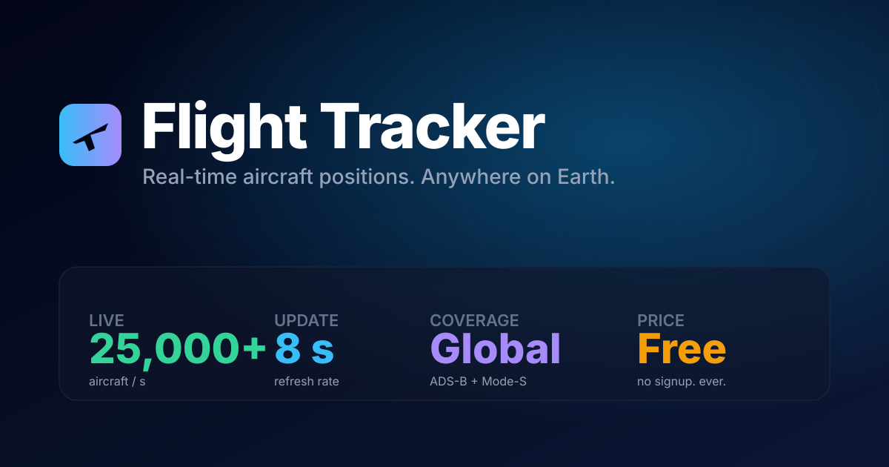

# ✈️ Flight Tracker

> Real-time global flight tracker. 25,000+ aircraft live. Free, no signup.

**Live:** https://sanjays2402.github.io/flight-tracker/

A single-page web app showing every aircraft transmitting ADS-B or Mode-S, anywhere on Earth, refreshed every 8 seconds. No servers, no accounts, no analytics, no ads — just a map and the planes in the sky.



## Features

**Map**
- Live aircraft positions worldwide (adsb.lol community feed)
- 3D terrain with adjustable tilt + chase cam
- Dark Carto basemap, weather radar overlay, night-side shading
- Heatmap, contrail trails, motion smoothing (rAF dead-reckoning)
- Hidden tabs back off live polling and refetch instantly on return — kinder to the community feed and your battery

**Aircraft details**
- Routes (origin → destination with airport names)
- Aircraft photos (planespotters.net)
- Altitude / speed / heading / squawk
- Type, registration, operator
- Watchlist with browser notifications when a plane returns

**Discovery**
- Live filter: type, altitude band, military, helicopter, heavy
- Search: callsign / hex / type / operator / registration
- List view, compare two flights side-by-side
- Live stats panel: histograms, top operators, busiest airports, country breakdown
- Ticker: fastest / highest / steepest climber / descender / military

**Mobile**
- Installable as PWA (Add to Home Screen)
- Hamburger menu + slide-in search
- Touch-optimized zoom/pan/tilt

## Data sources

| Source | Purpose | Cost |
|---|---|---|
| [adsb.lol](https://adsb.lol) | Aircraft positions, routes, airport DB | Free, community-hosted |
| [planespotters.net](https://www.planespotters.net) | Aircraft photos | Free public API |
| [RainViewer](https://www.rainviewer.com) | Weather radar | Free |
| [OpenStreetMap](https://www.openstreetmap.org) + [CARTO](https://carto.com) | Basemap | Free |
| [AWS Terrain Tiles](https://registry.opendata.aws/terrain-tiles/) | 3D elevation | Free public dataset |

No API keys required. adsb.lol and aviationweather.gov don't send CORS headers, though, so the browser reaches them through a small CORS proxy (see [Deploy](#deploy)).

## Privacy

- No backend, no servers, no logs.
- No analytics, no trackers, no cookies.
- Preferences and watchlist stored only in `localStorage`.
- Data fetched directly from public ADS-B endpoints — nothing flows through us.

## Stack

- Next.js 14 (app router, static export)
- React + TypeScript
- MapLibre GL JS
- Tailwind CSS
- Deployed via GitHub Pages

**Bundle size:** 1.44 kB route / 105 kB first-load shared.

## Develop

```bash
git clone https://github.com/Sanjays2402/flight-tracker
cd flight-tracker
npm install
npm run dev      # http://localhost:3000
npm run build    # static export → ./out
```

## Deploy

Pushes to `main` auto-deploy to GitHub Pages via `.github/workflows/deploy.yml`.

### CORS proxy (required for live data)

The static build calls the feeds through a proxy chosen at build time ([lib/proxy.ts](lib/proxy.ts)):

1. **Own Worker (recommended).** [proxy/worker.js](proxy/worker.js) is a ~60-line Cloudflare Worker that only forwards to the feed hosts and only answers this site's origin. Deploy it on the free plan:

   ```bash
   cd proxy && npx wrangler deploy
   ```

   Then set the repo variable `PROXY_URL` to `https://ft-proxy.<your-subdomain>.workers.dev/?url=` (Settings → Secrets and variables → Actions → Variables) and re-run the deploy workflow.

2. **corsproxy.io key.** Create a key at [console.corsproxy.io](https://console.corsproxy.io/), restrict it to your Pages domain, and save it as the repo secret `CORSPROXY_KEY`. The key ships in the client bundle, so the domain restriction is what protects it.

For local development, put either value in `.env.local` as `NEXT_PUBLIC_PROXY_URL` or `NEXT_PUBLIC_CORSPROXY_KEY`.

## Caveats

- Coverage depends on community ADS-B receivers. Oceans, polar regions, and military airspace may show fewer aircraft.
- Position data is delayed 5–30 seconds.
- **Never use this for navigation or safety-critical purposes.**

## License

MIT — see [LICENSE](LICENSE)

---

Built by [@Sanjays2402](https://github.com/Sanjays2402). Issues + PRs welcome.
